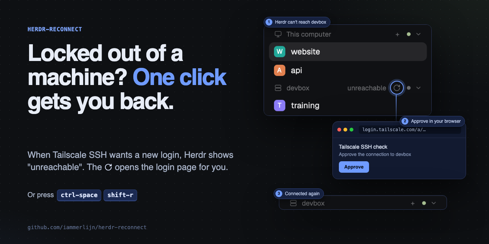
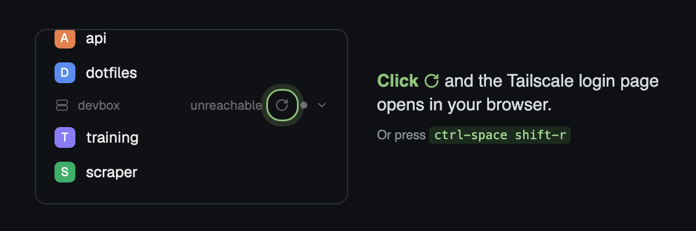
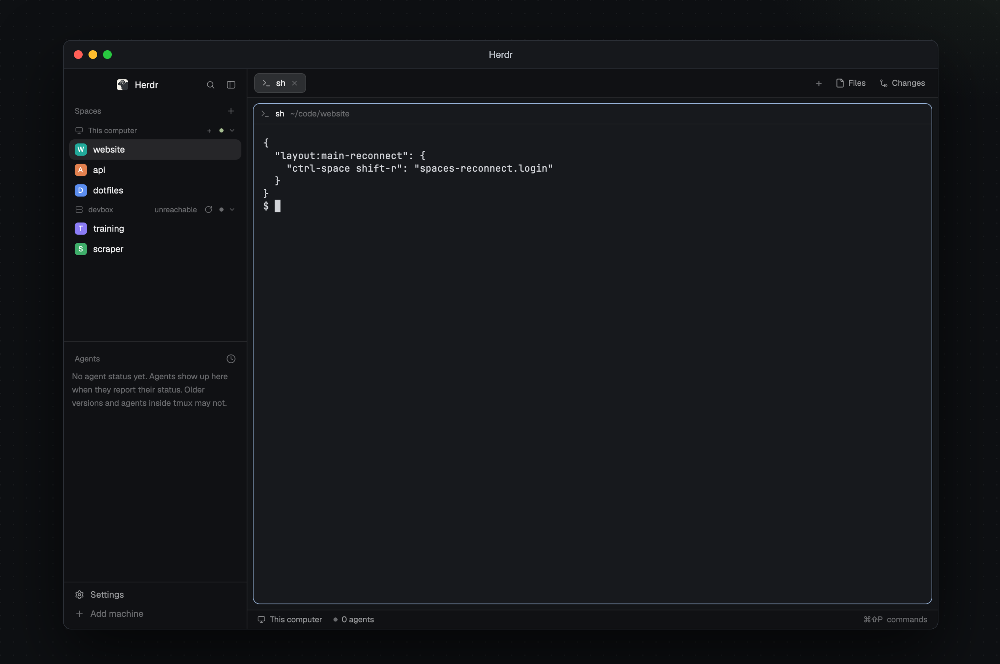

# Herdr Reconnect



A ⟳ button in the spaces list of the [Herdr](https://herdr.dev) desktop app. When a machine can't be reached because Tailscale SSH wants a new login check, click ⟳ and the login page opens in your browser. Approve it, and Herdr connects again by itself.



- **A button where you need it.** Each machine that is not connected gets a ⟳ next to its state in the sidebar.
- **A key too.** `ctrl-space shift-r` does the same for every machine that shows a ⟳.
- **Nothing to set up.** The machine's SSH target comes from Herdr's own machine list (`hc machine ls`). There are no settings, and the mod stores nothing.
- **Everything the spaces list already does.** It's Herdr's own spaces mod (0.1.16) with the button added.



## Why

Tailscale SSH can ask for a new login check after some time. `ssh` then prints a `login.tailscale.com` URL and waits. Herdr connects in the background, so you never see that URL: the machine just shows **unreachable**. The ⟳ gets the URL for you.

## Install

Use [space folders](https://github.com/jankeesvw/herdr-space-folders)? Don't install the mod below: add the button to space folders instead (see [With space folders](#with-space-folders)). An AI agent that installs this from `RECIPE.md` asks you first.

Clone this repository and copy the mod and the layout into Herdr's home:

```sh
git clone https://github.com/iammerlijn/herdr-reconnect.git
cp -R herdr-reconnect/mods/spaces-reconnect ~/.config/herdr-app/mods/
cp herdr-reconnect/layouts/main-reconnect.json ~/.config/herdr-app/layouts/
herdr-app check ~/.config/herdr-app/mods/spaces-reconnect
herdr-app do layout.switch --name main-reconnect
```

`main-reconnect` is Herdr's own `main` layout (0.1.16) with the spaces list swapped for this one. `ctrl-shift-l` switches back to any other layout.

For the key, add the `layout:main-reconnect` section of this repository's `keys.json` to `~/.config/herdr-app/keys.json`.

### Your own layout

In a layout of your own, point the spaces block at this mod:

```json
{ "id": "spaces", "type": "block", "size": { "weight": 1 }, "min": 90, "content": { "mod": "spaces-reconnect" } }
```

and give `keys.json` the same key in a section named after that layout, `layout:<name>`.

### With space folders

Use [space folders](https://github.com/jankeesvw/herdr-space-folders) by Jankees van Woezik? Keep it, and add the button to it with `patches/space-folders.patch` (17 lines and the icon):

```sh
patch -p1 -d ~/.config/herdr-app/mods/space-folders < herdr-reconnect/patches/space-folders.patch
herdr-app check ~/.config/herdr-app/mods/space-folders
```

For the key, add this line to the `layout:main-folders` section of `~/.config/herdr-app/keys.json`:

```json
"ctrl-space shift-r": "space-folders.login"
```

The key goes through space folders' own command loop, next to its `next` and `prev`. The patch fits space folders as of commit `26442c6`. If space folders is a link to its git clone, take the patch out before a `git pull` (`patch -R -p1` with the same file), then apply it again.

### Another spaces mod

To add the button to another spaces mod, port these parts from `mods/spaces-reconnect/main.js` (`patches/space-folders.patch` is a worked example):

1. `openLogin()` and `loginable()`: copy them as they are, under the imports. Add `exec` to the `herdr` import if the mod doesn't import it.
2. The icon: copy `rotate-cw.svg` into the mod's folder and change the path in `svg("mods/<your mod>/rotate-cw.svg")`.
3. The button: add it to the machine header, after the state text. The condition is `m && loginable(machine)`. Drop `!rebuilt` if the mod has no `rebuilt()` (space folders has none).
4. The key (optional): if the mod already has a `nextCommand()` loop, add `if (c === "login") …` to that loop. Don't start a second loop: two loops take commands from each other, so `login` or the mod's own commands get lost. Only a mod with no loop gets the loop from `init()`, with `nextCommand` and `checking` added to the import.

Then run `herdr-app check` on the mod.

## What it runs

When you click ⟳ (or press the key), and only then, the mod runs this on your computer:

```sh
ssh -o BatchMode=yes -o ConnectTimeout=10 -- <target> true
```

- `<target>` is the machine's SSH target from `hc machine ls`, passed as one argument. Machines that Herdr reaches with `--via` get no button.
- `BatchMode=yes`: ssh never asks for a password or a key.
- Only a line `# To authenticate, visit: https://login.tailscale.com/…` from that output is used. Its URL is opened with `open` (macOS) or `xdg-open` (Linux). No other URL is ever opened.
- ssh waits until you approve the login (at most 5 minutes), then stops. Herdr then connects to the machine again by itself.

Nothing is written to disk, and nothing is sent anywhere except the normal SSH connection.

## Herdr TUI

Use the Herdr TUI instead? It has no sidebar buttons, but a key does the same. Put this in `~/.config/herdr/config.toml`, with your machine's SSH host in place of `my-machine`:

```toml
[[keys.command]]
key = "prefix+alt+t"
type = "shell"
command = "ssh -o BatchMode=yes -- my-machine true 2>&1 | grep -m1 -oE '^# To authenticate, visit: https://login\\.tailscale\\.com/[A-Za-z0-9/]+' | while read -r _ _ _ _ url; do open \"$url\" 2>/dev/null || xdg-open \"$url\"; done"
description = "Tailscale login"
```

## License

MIT (`LICENSE`). The mod started as a copy of the spaces mod that ships with [Herdr](https://herdr.dev); that code keeps Herdr's Apache License 2.0 (`LICENSE-APACHE`).
