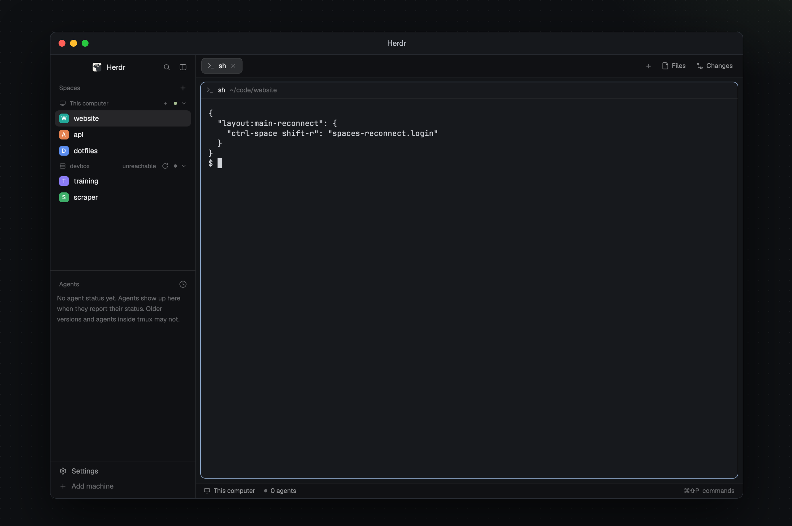

# Herdr Reconnect

Herdr's spaces list with a ⟳ button on each machine that isn't connected. A click opens that machine's Tailscale SSH login page in the browser; after the person approves it, Herdr connects again by itself.

## Before you install

Look at which mod draws the spaces list in the person's shown layout (`herdr-app status` names the layout; find the block with `"id": "spaces"` in `layouts/<name>.json`).

- **`space-folders`** (Jankees van Woezik's space folders): don't install `spaces-reconnect`, because that layout would lose the folders. Ask the person first, then apply `patches/space-folders.patch` to `mods/space-folders/` (`patch -p1 -d ~/.config/herdr-app/mods/space-folders < patches/space-folders.patch`), run `herdr-app check` on it, and add `"ctrl-space shift-r": "space-folders.login"` to the `layout:<that layout>` section of `keys.json`.
- **`spaces`** (Herdr's own): install as usual: `mods/spaces-reconnect/`, `layouts/main-reconnect.json`, `keys.json`.
- **Any other mod:** ask the person. Port the button to that mod as the README's "Another spaces mod" lists (one `nextCommand()` loop only), or install `spaces-reconnect` as usual.

## What you see

- **The spaces list** exactly as Herdr's own `spaces` mod (0.1.16) draws it: spaces per machine, a 26px header per machine once another machine is known.
- **A machine header that isn't connected** (any state but `connected` and `needs_login`, and not a "rebuilt" machine): after the `dim` state text (such as "unreachable"), a 12px `rotate-cw` icon in a box with `px(3)` and 4px corners. On hover the box gets `hover` and the icon `foreground`, with the tooltip "Log in with Tailscale (opens the browser)".
- Machines added with `--via` get no button. "This computer" never does.

## How it behaves

- Clicking ⟳ doesn't fold the machine (the click stops there). It runs, on this computer: `ssh -o BatchMode=yes -o ConnectTimeout=10 -- "$1" true`, with the machine's `target` from `hc machine ls --json` as `$1`, and reads its output for the first line `# To authenticate, visit: https://login.tailscale.com/…`. That URL, and only that, is opened with `open` (or `xdg-open`). The ssh waits until the login is approved; the run times out after 5 minutes.
- No login needed, or another error: nothing opens.
- `spaces-reconnect.login` (bound to `ctrl-space shift-r` in `layout:main-reconnect`) does the same for every machine that shows a ⟳.
- Agent statuses (working, blocked, done, idle) are as in Herdr's spaces list; the button doesn't change them.

## Built from

- **Mod** `mods/spaces-reconnect/`: `mod.clone` of Herdr's `spaces` (0.1.16). Added: `openLogin(target)` (one `exec("sh", ["-c", script, "sh", target], {timeout: 300000})`), `loginable(machine)`, the button in the machine header after the state text, and a `nextCommand()` loop for `login` (not started while `checking()`).
- **Icon** `mods/spaces-reconnect/rotate-cw.svg`: Lucide `rotate-cw`, `stroke="currentColor"`.
- **Layout** `layouts/main-reconnect.json`: Herdr's `main` 0.1.16 with the `spaces` block's mod set to `spaces-reconnect`.
- **Keys** `keys.json`: `layout:main-reconnect` → `ctrl-space shift-r`: `spaces-reconnect.login`.
- **herdr**: `exec`, `hc` (`machine ls --json`, already in the spaces mod), `nextCommand`, `checking`.

## Watch out

- The target goes to `sh` as a positional argument and to ssh after `--`: never put it in the script text.
- `exec` waits for ssh, which waits for the login, so the open must happen inside the pipe (`while read … open`), not after `exec` resolves.
- Herdr's own state for a machine that needs a password is `needs_login`; the spaces list already shows `hc machine login` for it, so the button skips it.
- Herdr doesn't reload a mod from a symlinked folder when a file changes: copy it, or recreate the link.

## Done when

- `herdr-app check ~/.config/herdr-app/mods/spaces-reconnect` passes.
- A machine that shows "unreachable" has a ⟳; a connected machine and "This computer" have none.
- With a Tailscale SSH check pending, clicking ⟳ opens `https://login.tailscale.com/a/…` in the browser; the machine row doesn't fold.
- `herdr-app do spaces-reconnect.login` runs the same ssh for each machine with a ⟳.
